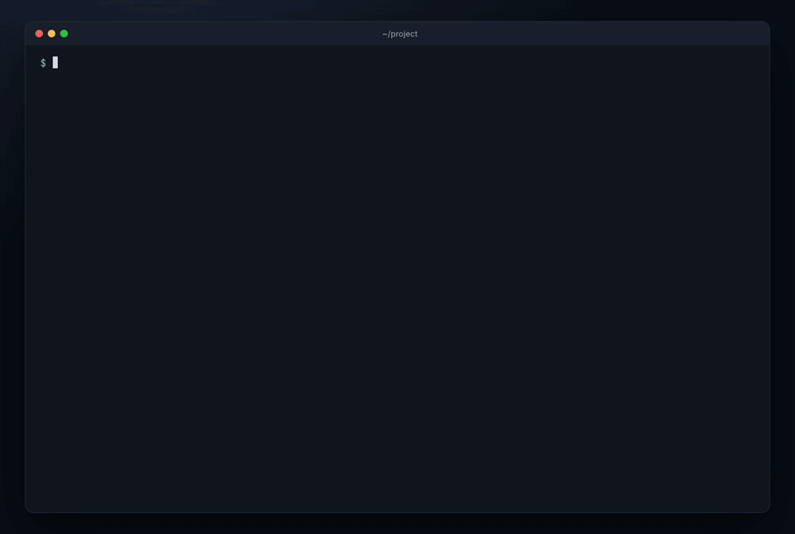

<p align="center">
  
</p>

<h1 align="center">agent-leakcheck</h1>

<p align="center">
  <b>See what your coding agents can reach on your machine, then fix it in one command.</b><br>
  Claude Code · Codex CLI · Cursor · Gemini CLI
</p>

<p align="center">
  
  
  
  
</p>

<p align="center">
  
</p>
<p align="center"><sub>Real output on a demo home folder. Paths are shortened to <code>~</code>.</sub></p>

Coding agents run with your permissions. agent-leakcheck checks what they can reach: `.env` files, plaintext tokens, SSH keys, credential file permissions, risky auto-approve modes and an outdated Claude Code. You get a grade from A to F, one finding per problem and one fix per finding.

## Quick start

```sh
npx @globalmpc/agent-leakcheck
```

Then apply the safe fixes. Each changed file is backed up first.

```sh
npx @globalmpc/agent-leakcheck --fix
```

Requires Node >= 20. No dependencies, no install step, and nothing leaves your machine unless you opt in.

## Why

[snyk/agent-scan](https://github.com/snyk/agent-scan) checks what is inside your agent's tools and skills. agent-leakcheck checks what the agent itself can reach. They cover different layers, so use both.

## What it checks

| id | Severity | Fails when |
|---|---|---|
| `env-deny` | high | An installed agent has no deny or ignore rule covering `.env` files (user level or in the current project). Codex rows are info only: its permission profiles are beta. |
| `risky-mode` | high | An auto-approve, bypass, yolo or full-access mode is the default. Also Claude Code `Bash` or `Bash(*)` in `permissions.allow`, and Gemini CLI bare `run_shell_command` in `tools.allowed` or `security.enablePermanentToolApproval: true`. |
| `cc-version` | medium | Claude Code is older than 2.1.317. |
| `mcp-plaintext` | medium | An MCP server config holds a literal secret-looking value in `env` or `headers` instead of an env var reference. |
| `mcp-autoapprove` | medium | Claude Code `enableAllProjectMcpServers: true` in user or local settings. |
| `gh-token` | medium | The GitHub CLI token is stored in its plain hosts file instead of the OS keyring. |
| `ssh` | medium | A private key in `~/.ssh` has permissions looser than 600. |
| `cred-perms` | medium | `~/.claude/.credentials.json`, `~/.codex/auth.json` or `~/.git-credentials` can be read by other users. |
| `secret-env` | warning | Exported env var names look like secrets (`*_TOKEN`, `*_KEY`, `*_SECRET`, `*_PASSWORD`, `*API_KEY*`). |
| `training` | info | Never passes or fails. Links to each provider's model-training data settings, which a local scan cannot read. |

Each rule is based on the agents' official docs. The sources are in [`docs/research/`](docs/research/).

### Grade

The score starts at 100. Each check that fails for at least one agent costs its weight once: high −25, medium −10. Warnings and info never change the score.

| A | B | C | D | F |
|---|---|---|---|---|
| ≥ 90 | ≥ 75 | ≥ 60 | ≥ 40 | below 40 |

## Privacy: what it never does

- It never opens `.env*` files, `~/.ssh/*` or the login files in `cred-perms`. It only checks whether they exist and what their permissions are.
- It reads config files that can hold secrets (MCP configs, the GitHub CLI hosts file) only to find key names. A value is checked only for whether it looks like a literal secret.
- It reads env var names, never their values.
- It prints names (server, key, env var, file), never values.
- It makes no network requests unless you share.

`test/trust.test.js` plants fake secrets and fails if any of them shows up in any output.

## `--fix`

`--fix` shows the planned changes, asks, backs up each file, then applies them. It only makes edits that set one key or add one array entry in an agent settings file:

- **Claude Code:** add `Read(//**/.env)` and `Read(//**/.env.*)` to `permissions.deny`; change `permissions.defaultMode` from `bypassPermissions` to `default`.
- **Cursor CLI:** add `Read(**/.env*)` to `permissions.deny`; change `approvalMode` from `unrestricted` to `allowlist`.
- **Codex:** change top-level `sandbox_mode` from `danger-full-access` to `workspace-write`.

Each file is first copied to `<file>.leakcheck-bak-<YYYYMMDDHHmmss>`. Deny rules do not cover every shell command, so a sandbox adds OS-level protection. Tokens, SSH keys and logins are never changed: those fixes are printed as instructions.

## Flags

| Flag | What it does |
|---|---|
| `--json` | Print the result as JSON on stdout. Never prompts. |
| `--fix` | Show the planned safe fixes, ask, back up each file, then apply. |
| `--yes` | Apply `--fix` without asking (required when there is no TTY). |
| `--show` | Print the exact data that sharing would send. Sends nothing. |
| `--share` | Share anonymous results without the prompt. |
| `--badge` | Print a README badge for your grade (static shields.io URL, no network). |
| `--fail-on high\|medium` | Exit 2 when a check of that severity or higher fails. |
| `--no-color` | Disable colors. `NO_COLOR` is respected too. |
| `--help`, `--version` | Show help or the version. |

Exit codes: `0` scan completed, `1` internal error, `2` usage error or `--fail-on` threshold met.

### Scripts and CI

`--fail-on` turns the scan into a gate. It checks the machine it runs on, so use it where agents actually run, such as a shared dev box or a dev container.

```sh
npx @globalmpc/agent-leakcheck --fail-on high
```

## Sharing (opt in)

After the report, an interactive run asks `Share anonymous results? [y/N]`. The default is no. `--share` shares without the prompt; `--show` prints the payload and sends nothing.

| Sent | Never sent |
|---|---|
| Tool version, OS family, grade, agent names and versions, pass/fail/skip per check id, and whether you used the prompt or `--share` | File paths, values, usernames, hostnames, env var names, MCP server names |

The server keeps counters only, never individual scans or IP addresses. See the [live stats](https://agent-leakcheck.vercel.app). Server code and privacy details: [`server/README.md`](server/README.md). Set `AGENT_LEAKCHECK_ENDPOINT` to share with your own server instead.

## Claude Code plugin

```
/plugin marketplace add globalmpc/agent-leakcheck
/plugin install agent-leakcheck@agent-leakcheck
```

The plugin runs `npx -y @globalmpc/agent-leakcheck@latest --json` and summarises the findings. It never runs `--fix` or `--share` unless you ask.

## Development

```sh
npm test              # CLI tests
npm run test:server   # share server tests
npm run lint          # syntax, import guards, no-dependency rule
node bin/cli.js       # scan this machine
```

`AGENT_LEAKCHECK_HOME`, `AGENT_LEAKCHECK_CWD` and `AGENT_LEAKCHECK_SYSTEM_ROOT` point the scan at a fake home, project and system root. They are for tests only.

## License

MIT

An open-source tool from [MPC](https://globalmpc.tech).
